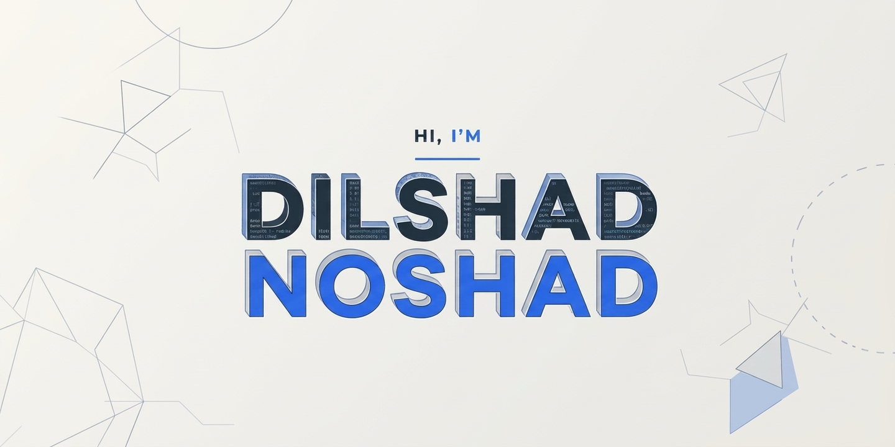

 <!-- ═══════════════ HEADER ═══════════════ -->
<div align="center">

<!--  -->



<br/>

<a href="https://github.com/DilshadNoshad">
  
</a>

<br/><br/>

<!-- ═══════════ BADGES: years old, views, followers ═══════════ -->


<br/><br/>

<a href="https://bio.link/dilshadnoshad"></a>
<a href="https://www.linkedin.com/in/dilshadnoshad"></a>
<a href="mailto:its.dilshad.dev@gmail.com"></a>
<a href="https://www.youtube.com/@programmerduck96"></a>

</div>

<br/>

<!-- ═══════════════ ABOUT ═══════════════ -->
<table align="center">
<tr>
<td width="260" align="center">
  
  <br/>
  <!-- <br/> -->
  <!--  -->
  <!-- <br/> -->
  <!-- <sub><b>🦆 Programmer Duck</b></sub> -->
</td>
<td>

### About Me 


I'm a **full-stack developer, passionate creator, and lifelong learner** who enjoys turning ideas into intuitive, reliable, and scalable digital experiences. I love combining thoughtful UI design with solid backend engineering to build technology that is both useful and enjoyable.

I believe in continuous learning, clean code, problem-solving, and sharing knowledge with the developer community.

```ts
const dilshad = {
  role: "Full-Stack Developer",
  interests: ["Software Engineering", "AI Engineering", "Cloud Architecture"],
  technologies: ["React", "Next.js", "TypeScript", "Node.js", "Flutter"],
  currentlyLearning: ["RAG", "LLMs", "Advanced DSA", "AWS"],
  problemSolving: "Competitive Programming & Codeforces",
  contentCreator: "Programmer Duck 🦆",
  openTo: "Learning, collaboration & open-source",
} as const;
```

</td>
</tr>
</table>

<!-- ═══════════════ NOW ═══════════════ -->
## ⚡ What I'm Up To

| 🔭 Exploring | 🌱 Learning | 💬 Ask me about | 📫 Reach me |
|:---:|:---:|:---:|:---:|
| AI-powered applications, scalable backend systems & modern web development | RAG, LLMs, AWS, advanced DSA & system design | JavaScript · TypeScript · React · Next.js · Node.js · Flutter | [its.dilshad.dev@gmail.com](mailto:its.dilshad.dev@gmail.com) |

<!-- ═══════════════ TECH STACK ═══════════════ -->
## 🛠️ Tech Stack

<div align="center">

**Frontend**


**Backend & Databases**


**Mobile · Cloud · Design · Tools**


</div>

<!-- ═══════════════ STATS ═══════════════ -->
## 📊 GitHub Analytics

<div align="center">


</div>

### 📈 Contribution Graph


### 🐍 Contribution Snake

<div align="center">
  <picture>
    <source media="(prefers-color-scheme: dark)" srcset="https://raw.githubusercontent.com/DilshadNoshad/DilshadNoshad/output/github-snake-dark.svg" />
    <source media="(prefers-color-scheme: light)" srcset="https://raw.githubusercontent.com/DilshadNoshad/DilshadNoshad/output/github-snake.svg" />
    
  </picture>
</div>

### 🏆 Trophies

<div align="center">
  
</div>

<!-- ═══════════════ CONNECT ═══════════════ -->
## 🌐 Let's Connect

<div align="center">

<a href="https://www.linkedin.com/in/dilshadnoshad"></a>&nbsp;&nbsp;
<a href="https://dev.to/dilshadnoshad"></a>&nbsp;&nbsp;
<a href="https://codepen.io/dilshadnoshad"></a>&nbsp;&nbsp;
<a href="https://www.youtube.com/@programmerduck96"></a>&nbsp;&nbsp;
<a href="https://www.instagram.com/programmerduck_official"></a>&nbsp;&nbsp;
<a href="https://fb.com/programmerduckofficial"></a>&nbsp;&nbsp;
<a href="mailto:its.dilshad.dev@gmail.com"></a>

<br/><br/>

<i>"Empowering tomorrow's tech with today's code."</i> 🦆

<!--  -->

</div>